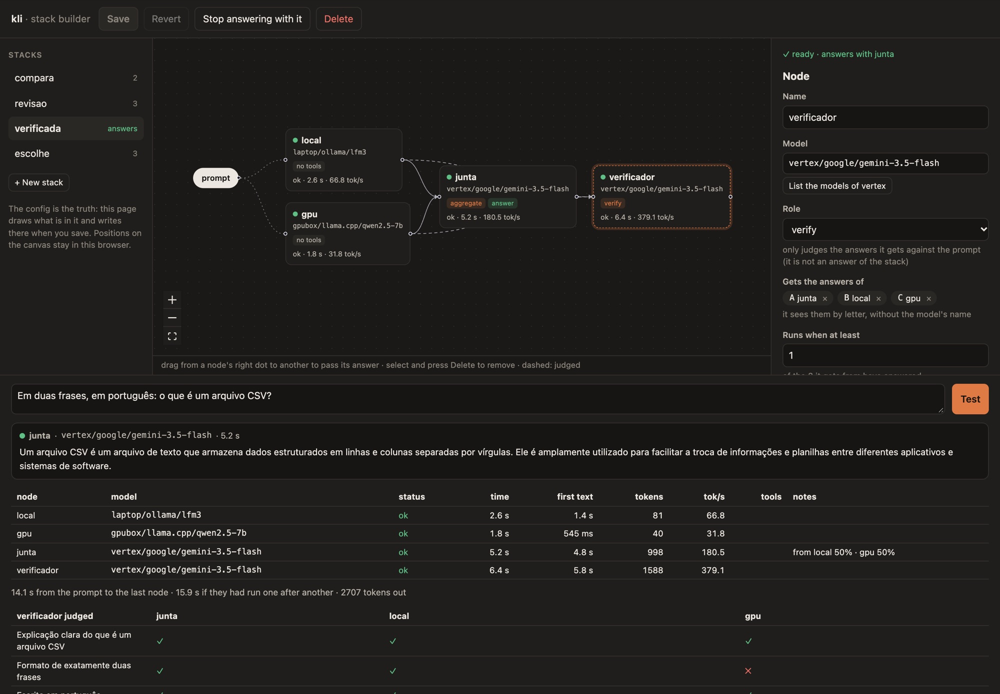

# Kli (כלי)

**One terminal for every inference source you have** (local servers, other machines over SSH, APIs and coding CLIs
such as Claude Code), **and model stacks**: graphs of models that answer as one.

[Português](README.pt-BR.md)



*Kli* is Hebrew for "instrument", "tool", "vessel". In the Kabbalah, the *kelim* are the vessels that receive and
carry the light. The mascot is a clay golem, made of the same clay as the vessel.

## What it does

- **Every source in one place.** Claude Code, Antigravity, OpenCode and Kimi Code as agents; Ollama, llama.cpp,
  LM Studio and vLLM on this machine or on another one over SSH (Kli opens the tunnels); Anthropic, Vertex AI and any
  OpenAI-compatible API (OpenAI, OpenRouter, Gemini, Groq, DeepSeek…). A model is named `location/provider/model`:
  `local/ollama/qwen3:4b`, `gpubox/llama.cpp/qwen2.5-7b`, `local/claude/sonnet`, `anthropic/claude-sonnet-5-5`.
- **A harness that works like Claude Code.** Read, Glob, Grep, Write, Edit and Bash with permission prompts,
  Shift+Tab for accept-edits and plan mode, `!command`, Ctrl+B to background a command, `AGENTS.md`, `CLAUDE.md` and
  `CLAUDE.local.md`.
- **Fallback, traces and stats.** When a model fails before answering, the next one in `fallback` takes over. Every
  step goes to a JSONL trace, and `kli stats` draws outcomes, latency and tokens per model.
- **Model stacks.** The same request to two or more models side by side, an aggregator that joins their answers, a
  verifier that judges each one against the request, a choice made by you or by a model, and agents that change the
  code each in its own copy of the folder while you apply the one you choose. Each step is measured.

## Install

A single binary for macOS and Linux (arm64 and x64), with no runtime to install:

```sh
mkdir -p ~/.local/bin
curl -fL "https://github.com/pacmanalx/kli/releases/latest/download/kli-$(uname -s | tr '[:upper:]' '[:lower:]')-$(uname -m | sed 's/x86_64/x64/;s/aarch64/arm64/')" -o ~/.local/bin/kli
chmod +x ~/.local/bin/kli
```

`~/.local/bin` must be on your `PATH`. Or build it from the source with [Bun](https://bun.sh) 1.4.4+:

```sh
git clone https://github.com/pacmanalx/kli.git && cd kli
bun install && bun test && bun run build      # dist/kli
```

Prefer to let your AI do it? Tell Claude Code or Antigravity: *"Read docs/instalacao.md from
https://github.com/pacmanalx/kli and install Kli for me."* (The guide is in Portuguese; your AI will cope.)

## Quickstart

You need at least one source: a logged-in coding CLI (`claude`, `agy`, `opencode`, `kimi`), a local server with a
model (`ollama pull qwen3:4b`), or an API key in `~/.kli/.env`. For stacks, two models.

```sh
kli init                                    # finds what this machine has and writes ~/.kli/config.json
kli check                                   # says "ok" to each model and measures it
kli --stack compare "what is a golem?"      # two models, side by side
kli                                         # a session in this folder: /model, /stack, /help
kli stackbuilder                            # draw, test and save stacks in the browser
```

`kli init` looks for the CLIs on your `PATH`, the servers on their usual ports (with their models) and the API keys
you have set, and writes a config with the strongest model as the default and the stacks below wired to what it
found:

```
On this machine
  ✓ Claude Code (claude)
  ✓ Antigravity (agy)
  ✓ Ollama on :11434 · qwen3:4b, gemma3:4b
  · LM Studio on :1234: not running
  · ANTHROPIC_API_KEY: not set

Wrote ~/.kli/config.json
  model   local/claude/sonnet
  stacks  compare, review, choose, agents
```

| Stack | What it does |
|---|---|
| `compare` | the same prompt to two models, their answers side by side |
| `review` | two models answer, the strongest joins them into one answer, and a verifier judges it against the request |
| `choose` | two models answer; you choose one on the full screen, or a model chooses when no one can (`kli -p`) |
| `agents` | with two CLIs: each changes the code in its own copy of the folder; a judge compares them and you apply the one you choose |

## Stacks

A stack is a graph in the config. Each node has a model and a role; `from` says whose answers it gets.

```json
"stacks": {
  "review": {
    "description": "two models answer, one joins them, a verifier judges the result",
    "nodes": {
      "qwen":  { "model": "local/ollama/qwen3:4b" },
      "gemma": { "model": "local/ollama/gemma3:4b" },
      "join":  { "model": "local/ollama/qwen3:4b", "role": "aggregate", "from": ["qwen", "gemma"] },
      "judge": { "model": "local/ollama/qwen3:4b", "role": "verify", "from": ["join", "qwen", "gemma"] }
    }
  }
}
```

| Role | What the node does |
|---|---|
| `answer` (default) | answers the prompt, or the answers it gets |
| `aggregate` | joins the answers it gets into one, and says how much came from each |
| `verify` | only judges: lists the request's requirements and marks each answer (✓ ~ ✕), giving its adherence |
| `choose` | picks one answer, by a `model`, by the `person` on the full screen, or both in order (`by`) |
| `ground` | no model: brings context from data sources (files) to the next step, to enrich or to restrict it |

Nodes with no inputs start together, and each node starts as soon as its inputs end. The models see the answers by
letter, never by name. A run of the `review` above, with two local models on Ollama (`kli -p`):

```
✓ lfm3  local/ollama/lfm3 · 4.1s · first token 3.5s · 1065→196 tokens
✓ qwen  local/ollama/qwen3:14b · 59.2s · first token 54.4s · 1051→238 tokens · 49.7 tok/s
✓ join  local/ollama/qwen3:14b · 47.0s · used qwen 70% · lfm3 30%
✓ judge local/ollama/qwen3:14b · 213.1s in 3 rounds · adherence lfm3 75 · qwen 100 · join 100

 ◇ adherence to the request · judged by judge
                                                       lfm3      qwen      join
 1. Explanation of what a CSV file is (content)        ~         ✓         ✓
 2. Exactly two sentences (format)                     ✓         ✓         ✓
 3. Concise and accurate (length)                      ~         ✓         ✓
 4. In the same language as the request (English)      ✓         ✓         ✓
```

More:

- **Nodes that write** (`"tools": "write"`): one node edits your folder; two or more each get a copy of it (an APFS
  clone on macOS, a reflink where Linux has one), run the project's check there, and you apply the changes you
  choose. Their commands run in a fence (`sandbox-exec` on macOS, `bwrap` on Linux): they write only in the copy and
  reach no network but this machine's.
- **Triage:** with `"triage": { "model": … }` and a stack's `purpose`, a small model reads each message first and
  sends what is not the stack's work ("thanks", "push it") to the model alone.
- **`/stackbuilder`:** a page served by Kli on `127.0.0.1` (React Flow) to draw the graph, test it with a prompt and
  save it to the config. The config stays the truth.
- **No clock:** no node has a time or step limit. Esc stops them all.

## Configuration

`$KLI_CONFIG`, `./kli.json` or `~/.kli/config.json`. API keys go in `~/.kli/.env` (mode 600), and the config only
names the variable (`apiKeyEnv`). Ready-made configs:

| File | Sources |
|---|---|
| [`examples/ollama.json`](examples/ollama.json) | Ollama only: two small local models (`ollama pull qwen3:4b`, `ollama pull gemma3:4b`) |
| [`examples/clis.json`](examples/clis.json) | Claude Code, Antigravity and OpenCode, with a planning stack and two agents writing |
| [`examples/apis.json`](examples/apis.json) | Anthropic, Gemini (AI Studio key, OpenAI-compatible endpoint) and OpenRouter |
| [`kli.example.json`](kli.example.json) | one location of each kind: this machine, machines over SSH with tunnels and a jump host, Vertex AI, Anthropic, an OpenAI-compatible API |

Inside a session, `/model` then **a** adds a source without editing the file; adding a machine finds its CLIs and
servers by itself, here or over SSH.

## In a session

| Key or command | What it does |
|---|---|
| `/model [name]` | choose the model, or add, edit and delete sources |
| `/stack [name]` | a stack answers instead of the model (`/stack off`) |
| `/triage [name]` | the small model that reads each message before a stack with a purpose |
| `/stackbuilder` | the stack builder page |
| `/stats`, `/status`, `/new`, `/help`, `/exit` | as you would expect |
| Shift+Tab | default → accept edits → plan mode |
| `!command` | you run a command yourself, with the terminal (a password or a login works); the model gets what it showed |
| Esc | stops the answer (every node of a stack) |
| Ctrl+B | sends a running command to the background |

The coding CLIs work as agents in the folder where `kli` runs, with their own tools, permissions and logins (Claude
Code and Antigravity with `--dangerously-skip-permissions`; in plan mode they only read). The local models and the
APIs use Kli's own tools, which ask before writing or running anything.

## Status

Version 0.1. macOS and Linux; Windows only through WSL, untested. Text only for now. No MCP yet.

The docs that describe every behavior and the reasons behind it are in Portuguese:
[`docs/kli.md`](docs/kli.md). The program itself, its messages and its code are in English.

## Development

TypeScript on Bun, with no runtime dependencies except React and React Flow for the stack builder page, bundled into
the binary. Providers are spoken to over plain HTTP (no SDKs); the agent loop and the terminal UI are Kli's own.

```sh
bun test               # no network, no real CLIs; your config, keys and sessions are left alone
bun run typecheck
bun run build          # dist/kli
bun run dev "prompt"   # straight from the source
bun run release        # dist/release: the four binaries and SHA256SUMS
```

A tag `v<version>` builds the binaries and publishes the GitHub release.

## License

[MIT](LICENSE.md) © 2026 Alexandre Pereira
