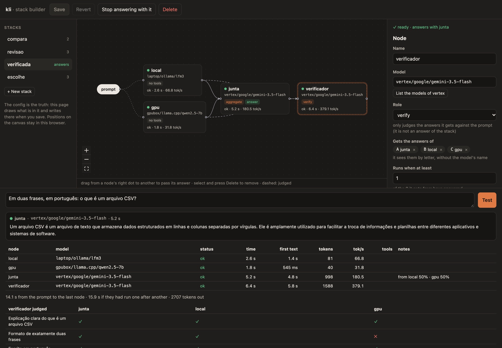

# Kli (כלי)

**Um terminal para todas as suas fontes de inferência** (servidores locais, outras máquinas por SSH, APIs e CLIs de
programação como o Claude Code), **e model stacks**: grafos de modelos que respondem como um só.

[English](README.md)



*Kli* quer dizer "instrumento", "ferramenta", "vaso" em hebraico. Na Cabala, os *kelim* são os vasos que recebem e
conduzem a luz. O mascote é um golem de barro, feito do mesmo barro do vaso.

## O que faz

- **Todas as fontes num lugar só.** Claude Code, Antigravity, OpenCode e Kimi Code como agentes; Ollama, llama.cpp,
  LM Studio e vLLM nesta máquina ou em outra, por SSH (o Kli abre os túneis); Anthropic, Vertex AI e qualquer API
  compatível com a OpenAI (OpenAI, OpenRouter, Gemini, Groq, DeepSeek…). Um modelo se chama `local/provedor/modelo`:
  `local/ollama/qwen3:4b`, `gpubox/llama.cpp/qwen2.5-7b`, `local/claude/sonnet`, `anthropic/claude-sonnet-5-5`.
- **Um harness que funciona como o Claude Code.** Read, Glob, Grep, Write, Edit e Bash com pedido de permissão,
  Shift+Tab para aceitar edições e para o plan mode, `!comando`, Ctrl+B para mandar um comando para o segundo plano,
  `AGENTS.md`, `CLAUDE.md` e `CLAUDE.local.md`.
- **Reserva, rastro e estatísticas.** Quando um modelo falha antes de responder, o próximo do `fallback` assume. Cada
  passo vai para um rastro em JSONL, e o `kli stats` desenha desfechos, latência e tokens por modelo.
- **Model stacks.** O mesmo pedido a dois ou mais modelos lado a lado, um agregador que junta as respostas, um
  verificador que julga cada uma contra o pedido, uma escolha feita por você ou por um modelo, e agentes que mudam o
  código cada um numa cópia da pasta enquanto você aplica a que escolher. Cada etapa é medida.

## Instalar

Um binário só, para macOS e Linux (arm64 e x64), sem runtime para instalar:

```sh
mkdir -p ~/.local/bin
curl -fL "https://github.com/pacmanalx/kli/releases/latest/download/kli-$(uname -s | tr '[:upper:]' '[:lower:]')-$(uname -m | sed 's/x86_64/x64/;s/aarch64/arm64/')" -o ~/.local/bin/kli
chmod +x ~/.local/bin/kli
```

O `~/.local/bin` precisa estar no `PATH`. Ou compile do código com o [Bun](https://bun.sh) 1.4.4 ou mais novo:

```sh
git clone https://github.com/pacmanalx/kli.git && cd kli
bun install && bun test && bun run build      # dist/kli
```

Prefere que a sua IA faça? Diga ao Claude Code ou ao Antigravity: *"Leia o docs/instalacao.md de
https://github.com/pacmanalx/kli e instale o Kli para mim."*

## Começo rápido

É preciso pelo menos uma fonte: um CLI de programação logado (`claude`, `agy`, `opencode`, `kimi`), um servidor local
com um modelo (`ollama pull qwen3:4b`) ou uma chave de API em `~/.kli/.env`. Para as stacks, dois modelos.

```sh
kli init                                    # acha o que esta máquina tem e grava ~/.kli/config.json
kli check                                   # manda "ok" a cada modelo e mede
kli --stack compare "o que é um golem?"     # dois modelos, lado a lado
kli                                         # uma sessão nesta pasta: /model, /stack, /help
kli stackbuilder                            # desenhe, teste e salve stacks no navegador
```

O `kli init` procura os CLIs no `PATH`, os servidores nas portas de sempre (com os modelos deles) e as chaves de API
que você já definiu. Com isso, grava uma configuração com o modelo mais forte como padrão e as stacks abaixo, ligadas
ao que achou:

```
On this machine
  ✓ Claude Code (claude)
  ✓ Antigravity (agy)
  ✓ Ollama on :11434 · qwen3:4b, gemma3:4b
  · LM Studio on :1234: not running
  · ANTHROPIC_API_KEY: not set

Wrote ~/.kli/config.json
  model   local/claude/sonnet
  stacks  compare, review, choose, agents
```

| Stack | O que faz |
|---|---|
| `compare` | o mesmo pedido a dois modelos, as respostas lado a lado |
| `review` | dois modelos respondem, o mais forte junta as respostas e um verificador julga o resultado contra o pedido |
| `choose` | dois modelos respondem; você escolhe uma na tela cheia, ou um modelo escolhe quando não há a quem perguntar (`kli -p`) |
| `agents` | com dois CLIs: cada um muda o código numa cópia da pasta; um juiz compara e você aplica a que escolher |

## Stacks

Uma stack é um grafo na configuração. Cada nó tem um modelo e um papel; `from` diz de quem ele recebe as respostas.

```json
"stacks": {
  "review": {
    "description": "two models answer, one joins them, a verifier judges the result",
    "nodes": {
      "qwen":  { "model": "local/ollama/qwen3:4b" },
      "gemma": { "model": "local/ollama/gemma3:4b" },
      "join":  { "model": "local/ollama/qwen3:4b", "role": "aggregate", "from": ["qwen", "gemma"] },
      "judge": { "model": "local/ollama/qwen3:4b", "role": "verify", "from": ["join", "qwen", "gemma"] }
    }
  }
}
```

| Papel | O que o nó faz |
|---|---|
| `answer` (padrão) | responde ao pedido, ou às respostas que recebe |
| `aggregate` | junta as respostas que recebe numa só, e diz quanto veio de cada uma |
| `verify` | só julga: lista os requisitos do pedido e marca cada resposta (✓ ~ ✕), com a aderência |
| `choose` | escolhe uma resposta, por um `model`, pela `person` na tela cheia, ou pelos dois em ordem (`by`) |
| `ground` | sem modelo: traz contexto de fontes de dados (arquivos) para a etapa seguinte, para enriquecer ou para limitar |

Os nós sem entrada começam juntos, e cada nó começa assim que as suas entradas terminam. Os modelos veem as respostas
por letra, nunca pelo nome. Uma rodada da `review` acima, com dois modelos locais no Ollama (`kli -p`):

```
✓ lfm3  local/ollama/lfm3 · 4.1s · first token 3.5s · 1065→196 tokens
✓ qwen  local/ollama/qwen3:14b · 59.2s · first token 54.4s · 1051→238 tokens · 49.7 tok/s
✓ join  local/ollama/qwen3:14b · 47.0s · used qwen 70% · lfm3 30%
✓ judge local/ollama/qwen3:14b · 213.1s in 3 rounds · adherence lfm3 75 · qwen 100 · join 100

 ◇ adherence to the request · judged by judge
                                                       lfm3      qwen      join
 1. Explanation of what a CSV file is (content)        ~         ✓         ✓
 2. Exactly two sentences (format)                     ✓         ✓         ✓
 3. Concise and accurate (length)                      ~         ✓         ✓
 4. In the same language as the request (English)      ✓         ✓         ✓
```

Mais:

- **Nós que gravam** (`"tools": "write"`): um nó só edita a sua pasta; dois ou mais ganham cada um uma cópia dela (um
  clone do APFS no macOS, um reflink onde o Linux tiver), rodam ali a checagem do projeto, e você aplica as mudanças
  que escolher. Os comandos deles rodam numa cerca (`sandbox-exec` no macOS, `bwrap` no Linux): gravam só na cópia e
  não alcançam rede nenhuma além da desta máquina.
- **Triagem:** com `"triage": { "model": … }` e o `purpose` de uma stack, um modelo pequeno lê cada mensagem antes e
  manda o que não é o trabalho da stack ("obrigado", "ok para push") para o modelo sozinho.
- **`/stackbuilder`:** uma página servida pelo Kli em `127.0.0.1` (React Flow) para desenhar o grafo, testar com um
  pedido e salvar na configuração. A configuração continua sendo a verdade.
- **Sem relógio:** nenhum nó tem limite de tempo ou de passos. O Esc para todos.

## Configuração

`$KLI_CONFIG`, `./kli.json` ou `~/.kli/config.json`. As chaves de API ficam em `~/.kli/.env` (modo 600), e a
configuração só diz o nome da variável (`apiKeyEnv`). Configurações prontas:

| Arquivo | Fontes |
|---|---|
| [`examples/ollama.json`](examples/ollama.json) | só Ollama: dois modelos locais pequenos (`ollama pull qwen3:4b`, `ollama pull gemma3:4b`) |
| [`examples/clis.json`](examples/clis.json) | Claude Code, Antigravity e OpenCode, com uma stack de planejamento e outra de dois agentes gravando |
| [`examples/apis.json`](examples/apis.json) | Anthropic, Gemini (chave do AI Studio, pelo endpoint compatível com a OpenAI) e OpenRouter |
| [`kli.example.json`](kli.example.json) | um local de cada tipo: esta máquina, máquinas por SSH com túnel e com salto, Vertex AI, Anthropic, uma API compatível com a OpenAI |

Numa sessão, `/model` e depois **a** cadastram uma fonte sem editar o arquivo; ao incluir uma máquina, o Kli acha
sozinho os CLIs e os servidores dela, aqui ou por SSH.

## Numa sessão

| Tecla ou comando | O que faz |
|---|---|
| `/model [nome]` | escolhe o modelo, ou inclui, edita e exclui fontes |
| `/stack [nome]` | uma stack responde no lugar do modelo (`/stack off`) |
| `/triage [nome]` | o modelo pequeno que lê cada mensagem antes de uma stack com finalidade |
| `/stackbuilder` | a página de montar stacks |
| `/stats`, `/status`, `/new`, `/help`, `/exit` | o esperado |
| Shift+Tab | padrão → aceitar edições → plan mode |
| `!comando` | você roda um comando, com o terminal (senha e login funcionam); o modelo recebe o que apareceu |
| Esc | para a resposta (todos os nós de uma stack) |
| Ctrl+B | manda para o segundo plano um comando que está rodando |

Os CLIs de programação trabalham como agentes na pasta onde o `kli` roda, com as próprias ferramentas, permissões e
logins (o Claude Code e o Antigravity com `--dangerously-skip-permissions`; no plan mode, só leem). Os modelos locais
e as APIs usam as ferramentas do próprio Kli, que perguntam antes de gravar ou de rodar qualquer coisa.

## Estado

Versão 0.1. macOS e Linux; Windows só pelo WSL, sem teste. Por enquanto, só texto. Ainda sem MCP.

O comportamento inteiro, com o porquê de cada decisão, está em [`docs/kli.md`](docs/kli.md). O guia de instalação
para a sua IA seguir está em [`docs/instalacao.md`](docs/instalacao.md). O programa em si, as mensagens e o código
são em inglês.

## Desenvolvimento

TypeScript no Bun, sem dependências de execução além do React e do React Flow da página do stackbuilder, empacotados
no binário. Os provedores são chamados por HTTP direto (sem SDK); o laço do agente e a tela são do próprio Kli.

```sh
bun test               # sem rede, sem os CLIs de verdade; a sua configuração, as chaves e as sessões ficam intactas
bun run typecheck
bun run build          # dist/kli
bun run dev "pedido"   # direto do código
bun run release        # dist/release: os quatro binários e o SHA256SUMS
```

Uma tag `v<versão>` compila os binários e publica o release no GitHub.

## Licença

[MIT](LICENSE.md) © 2026 Alexandre Pereira
